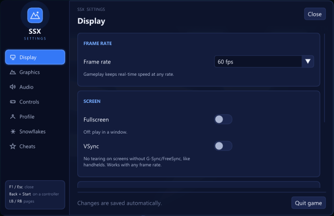

<div align="center">

# 🏂 SSX (2012) — Native PC Port

**EA's SSX, running natively on Windows and Linux — up to 300 fps, up to 4K, no emulator.**

[](../../releases/latest)
[](#installing)
[](#linux)
[](LICENSE)
[](https://discord.gg/5GyEyDJ8BX)
<a href="https://playported.com/ports/1191-ssx/"></a>

<a href="https://recomplauncher.com/game/ssx-recomp"><picture><source media="(prefers-color-scheme: dark)" srcset="https://recomplauncher.com/assets/press/launcher/badge-light.svg"></picture></a>

[⬇️ Download](../../releases/latest) · [🎬 Gameplay](#gameplay) · [✨ Features](#features) · [🛠️ Install](#installing) · [🎮 Controls](#playing) · [🖥️ Graphics](#graphics) · [📦 DLC](#adding-dlc) · [🎵 Music](#your-music) · [🩺 Help](#help) · [💬 Discord](https://discord.gg/5GyEyDJ8BX) · [🗺️ Roadmap](#roadmap) · [📝 Changelog](../../releases)

</div>

> [!CAUTION]
> **You need your own copy of SSX (USA) for Xbox 360**, dumped from your own disc to an ISO. This
> repository contains no EA code or content, and none is downloaded. ISOs and pre-built games will
> not be provided.

SSX's Xbox 360 code is statically recompiled to x86-64 with the
[ReXGlue SDK](https://github.com/rexglue/rexglue-sdk) and built on your own PC from your ISO. The
graphics run on Direct3D 12, and on Linux through Vulkan.

<a id="gameplay"></a>
<a id="screenshots"></a>

## 🎬 Gameplay

<div align="center">

[](https://www.youtube.com/watch?v=ibGjbR-AqRo)


 

</div>

<a id="features"></a>

## ✨ Features

| Feature | What it does | Where |
|---|---|---|
| ⚡ **Up to 300 fps** | 30 to 300 fps or your monitor's rate, at real-time game speed | F1 → Display |
| 🖥️ **Up to 4K** | draws at your screen's resolution, from 720p to 4K | F1 → Graphics |
| 🧊 **Far less stutter** | prepares the game's shaders on the first start | automatic |
| ⌨️ **Keyboard & controller** | key rebinding, vibration and deadzone | F1 → Controls |
| 🪪 **Your name & picture** | shown instead of "User" and an empty square | F1 → Profile |
| 🏅 **Online-only badges** | shows the badges that need EA's servers as earned | F1 → Profile |
| ❄️ **Snowflake tracker** | lists the snowflakes you have on every drop | F1 → Snowflakes |
| 🏂 **Boost meter in freeride** | shows the boost and Tricky meters while you freeride | F1 → Display |
| 🎒 **Gear by type** | sorts View More by type, the highest level first | F1 → Display |
| 🎮 **Cheats** | infinite boost, slow motion, ride uphill and [more](#cheats) | F1 → Cheats |
| 📦 **DLC & title update** | from your own console, with riders up to level 15 | `ssx-recomp.exe` |
| 🎵 **Your own music** | your folders as playlists, remixed live as you ride | the game's Music menu |

<a id="cheats"></a>

<details>
<summary><b>🎮 All cheats</b></summary>
<br>

| Group | Cheats |
|---|---|
| 🏂 **Riding** | Infinite boost · Tricky (Always Tricky, Always Super Tricky or Never) · Infinite rewinds · No rewinds · Slow motion · Never lose combo · Never lose multiplier · Ride uphill · No reverse camera |
| 💰 **Credits** | Everything is free · Give credits (+1,000,000) |
| 🎒 **Gear** | Infinite lift (wingsuits) · Infinite battery life (headlamps, pulse goggles) · Infinite durability (wingsuit, armour, ice axes) · Infinite tank size (oxygen tanks) · Infinite cold protection (solar panels) · Max gear stats |
| 🤪 **Just for fun** | Big head mode · Big hands mode · Glowing suit |

</details>

<a id="installing"></a>

## 🛠️ Install

The setup builds the game on your own PC from your ISO, and installs the build tools it needs.

### 🪟 Windows

1. **Download** `ssx-recomp.exe` from the [latest release](../../releases/latest) into an empty
   folder, like `C:\Games\SSX`. That folder is your SSX folder.
2. **Run** it. If SmartScreen warns, click **More info → Run anyway**.
3. **Install:** click **Get started**, pick your ISO (or an extracted disc's `default.xex`) and
   click **Install**. **Add files...** adds [DLC and the title update](#adding-dlc) right away.
4. **Play:** click **Play**. From then on, `ssx-recomp.exe` is the game's launcher.

Or install it with [RecompLauncher](https://recomplauncher.com/game/ssx-recomp): drop in your ISO and
it builds the game for you.

<a id="linux"></a>

### 🐧 Linux (beta)

1. **Download** `ssx-linux-installer.sh` from the [latest release](../../releases/latest).
2. **Run** `bash ssx-linux-installer.sh --iso ~/Games/SSX.iso` in a terminal. Add
   `--title-update <file>` for [the title update](#title-update).
3. **Install:** it installs the missing build tools (it asks for your password) and builds the game.
4. **Play:** when it says **DONE**, start **SSX** from your app menu.

### 📋 Requirements

| | 🪟 Windows | 🐧 Linux (beta) |
|---|---|---|
| **System** | Windows 10 or 11, 64-bit | tested on CachyOS; Debian, Ubuntu and Fedora untested |
| **Free space** | about 10 GB | about 15 GB |
| **First build** | 10–30 minutes | 20–60 minutes |
| **Internet** | for the first build and for updates | for the first build and for updates |
| **Updating** | **Check for updates** in `ssx-recomp.exe` | run the script again |
| **Saves, DLC & music** | `source\dist\SSX\userdata` in the SSX folder | `~/.local/share/ssx` |
| **Build log** | `source\build-ssx.log` in the SSX folder | `~/SSX-PC/source/build-ssx-linux.log` |

> [!IMPORTANT]
> **Keep your ISO where it is.** The game reads its data from it every time it starts.

<details>
<summary><b>🔍 What the Windows setup does</b></summary>
<br>

1. **Unpacks** the port's source code, which `ssx-recomp.exe` carries, into `source`.
2. **Checks** that your ISO is the supported release.
3. **Installs** the missing build tools: CMake, Ninja, LLVM and the Visual Studio Build Tools.
   Windows asks for permission for LLVM and Visual Studio.
4. **Downloads** the prebuilt ReXGlue SDK and ReGPU renderer. Neither contains game code.
5. **Builds** the game into `source\dist\SSX`.

The source is in [`installer/SSXInstaller.cs`](installer/SSXInstaller.cs). Playing never goes
online, and a rebuild without new build tools works offline.

</details>

<details>
<summary><b>♻️ Coming from an older version</b></summary>
<br>

- **`SSX-Installer.exe`:** put `ssx-recomp.exe` in that install folder (`SSX-PC` in your user
  folder, unless you picked another), run it, then click **Install / Manage → Rebuild**.
- **Saves in `Documents\ssx`:** the first start copies them, with your DLC and music, into the SSX
  folder. `Documents\ssx` stays as it was.

</details>

<details>
<summary><b>🐧 Linux notes</b></summary>
<br>

- **Folder:** the port goes to `~/SSX-PC`; `--folder` picks another place.
- **Your own music:** needs `ffmpeg`.
- **Not on Linux yet:** the gamer picture, and building with RecompLauncher.
- **Standard renderer:** 1× only.

</details>

<details>
<summary><b>💿 Supported disc</b></summary>
<br>

| | |
|---|---|
| **Game** | SSX (USA), Xbox 360 |
| **Title ID / Media ID** | `4541096D` / `55ABAB6C` |
| **`default.xex` SHA-256** | `F509845401D65A6791C5D28A3E9636A6558DA204F3851028B0B369A44A4B68EA` |
| **Title update** | 0.0.3.2 (optional) |

Some ISOs named "World" contain this same release; the setup checks it for you.

</details>

<a id="playing"></a>

## 🎮 Controls

A controller works as on the console. The keyboard's default keys can be changed in
**F1 → Controls**.

| Controller | Keyboard |
|---|---|
| **Left stick** | W A S D |
| **Right stick** | arrow keys |
| **A / B / X / Y** | Space / Backspace / L / P |
| **LT / RT** | Q / E |
| **LB / RB** | 1 / 3 |
| **D-pad** | Shift + arrow keys |
| **Start / Back** | Enter / Tab |
| **Left / right stick click** | F / K |

### ⚙️ Settings menu

| Action | Keyboard & mouse | Controller |
|---|---|---|
| **Open** | F1 | Back + Start |
| **Move** | mouse | D-pad |
| **Change a setting** | click | A |
| **Switch page** | click the page | LB / RB |
| **Close** | F1 or Esc | Back + Start |

**Quit game** is at the bottom right of the menu.

<a id="graphics"></a>
<a id="regpu"></a>

## 🖥️ Graphics

ReGPU is the default renderer. Switch in **F1 → Graphics → Renderer**, then restart.

| | 🚀 ReGPU (default) | 🔧 Standard |
|---|---|---|
| **What it is** | [ReGPU](https://github.com/zer0ducksgiven/ReGPU), a lean Direct3D 12 renderer for recompiled Xbox 360 games | the ReXGlue SDK's emulation of the Xbox 360's graphics chip |
| **Resolution** | your screen's, from 720p to 4K, changed while you play | 1200×640 at 1×, 2× or 3× |
| **Speed** (RTX 4080 SUPER) | about 200 fps at 1440p, 110 at 4K | about 140 fps at 2×, [3× locked to 60](#frame-rate-lock) |
| **Image options** | — | AMD FSR 1, CAS, FXAA |
| **Linux** | yes | 1× only |

- **Frame rate:** **F1 → Display → Frame rate**: 30 to 300, or match your monitor.
- **Fallback:** if ReGPU can't start, the game uses the standard renderer at the next start.
- **Ultrawide:** the picture stays 16:9 for now.

<a id="frame-rate-lock"></a>

<details>
<summary><b>🔒 Why the standard renderer's 3× is locked to 60 fps</b></summary>
<br>

3× draws about 4K (3600×1920) through an emulation of the Xbox 360's video memory. Even an RTX 4080
SUPER runs at its limit there: above 60 fps the frame rate jumps around, and some graphics drivers
hang. 4× was removed for the same reason. 2×, or ReGPU, is recommended.

</details>

<a id="adding-dlc"></a>

## 📦 DLC & title update

Neither comes with the game: both come from your own Xbox 360.

| Package | Size | Adds |
|---|---|---|
| 🏔️ **SSX Mount Eddie** | ~250 MB | the Mt. Eddie region and the classic riders |
| 🎁 **SSX Presell Pack** | ~9 MB | Japan (Mount Fuji), Eddie as a rider and Mac's Ultimate Board |
| 🗾 **SSX Japan Range** | ~9 MB | Japan (Mount Fuji) |
| 🧔 **SSX Eddie Pack** | <1 MB | Eddie as a rider |
| 🏂 **SSX Mac Board Pack** | <1 MB | Mac's Ultimate Board |
| 📈 **Title update 0.0.3.2** | ~9 MB | the gear for levels 11 to 15, and riders up to level 15 |

The Presell Pack already contains the Japan Range, Eddie Pack and Mac Board Pack.

1. **Open** `ssx-recomp.exe` and click **Install / Manage** (the first time: **Get started**).
2. **Add** the files with **Add files...**. It shows what each file is.
3. **Finish** with **Add DLC**, or **Rebuild** for the title update (the first time: **Install**).

<details>
<summary><b>📂 Getting the files off your console</b></summary>
<br>

Open your console's drive with an Xbox 360 file tool, like *FATXplorer*, *Velocity* or *Horizon*,
and copy the long-named package files themselves, not their folders.

| | Folder on the console |
|---|---|
| **DLC** | `Content\0000000000000000\4541096D\00000002\` |
| **Title update** | `Content\0000000000000000\4541096D\000B0000\` (with two files, take the larger one, ~9 MB) |

DLC can also be copied by hand into `userdata\dlc`: the game installs it at the next start, and its
log (in `logs` next to `ssx.exe`) shows `DLC: installed` for each package.

</details>

<a id="title-update"></a>
<a id="level-15"></a>

<details>
<summary><b>🎚️ The title update and levels 11 to 15</b></summary>
<br>

- **Level cap:** EA raised it from 10 to 15 with online tuning updates the port can't download.
  With the title update, the port applies the same level tables itself. A level 10 rider can buy
  access to level 11 for 1,000,000 credits, and so on up to 15.
- **EA's tuning update:** a save that already has it keeps using it.
- **Saves:** work with and without the title update.
- **Back to the disc version:** run `source\scripts\build-ssx.ps1 -NoTitleUpdate` in your SSX folder.
  It asks for your ISO again.

</details>

<a id="your-music"></a>

## 🎵 Your own music

SSX plays your own music instead of its soundtrack, and remixes it live as you ride.

1. **Copy** your music into `userdata\music`, one folder per playlist, like `music\Chill\`. MP3,
   M4A/AAC, WMA, FLAC and WAV work.
2. **Open** the game's music settings: **Back** on the main screen, then
   **Music → Personalize Your Music**.
3. **Pick** **Playlist** and one of your folders, for race, trick, survive or menu music.

<a id="help"></a>

## 🩺 Help

| Problem | Fix |
|---|---|
| **The picture tears** | turn on **VSync** in **F1 → Display** |
| **Too few frames** | lower **F1 → Graphics → Resolution** |
| **The game won't start after changing a setting** | delete `ssx.toml` next to `ssx.exe` |
| **The game asks for your ISO** | pick the ISO itself, not the `default.xex` in `source\game-dump` |
| **The build failed** | [open an issue](../../issues/new) with the build log ([where](#installing)) |
| **The game crashed or looks wrong** | [open an issue](../../issues/new) with a screenshot and the newest file in `logs` next to `ssx.exe` |
| **Anything else, or just want to chat** | ask in `#help` on the [Discord](https://discord.gg/5GyEyDJ8BX) |

<a id="roadmap"></a>

## 🗺️ Roadmap

| | |
|---|---|
| 🔧 **Being worked on** | playing through every region to find bugs · Linux on more PCs · the setup on more PCs |
| ⚠️ **Known issues** | only SSX (USA) is supported · ultrawide screens get a 16:9 picture · no gamer picture on Linux |
| 🌐 **Not possible** | online features (RiderNet, global events, online races): they need Xbox Live |

What changed in each version is on the [releases page](../../releases).

<a id="development"></a>

## 🧑‍💻 Development

<details>
<summary><b>🔨 Building it yourself</b></summary>
<br>

```powershell
powershell -ExecutionPolicy Bypass -File scripts\build-ssx.ps1 -Iso "D:\path\to\your\SSX.iso"
```

| Path | Holds |
|---|---|
| `src/` | the PC-side code: settings, launcher, hooks |
| `patches/` | the fixes applied to the ReXGlue SDK (`rexglue-*`) and to ReGPU (`regpu-*`) |
| `ssx_config.toml` | the recompilation overrides |
| `regpu-plugin/` | ReGPU as a ReXGlue GPU plugin, adapted from [Glue2GPU](https://github.com/zer0ducksgiven/Glue2GPU) |
| [`PROGRESS.md`](PROGRESS.md) | the development log |

The builder uses the CMake preset `ssx-player`, which builds against the prebuilt SDK package made
by [`scripts/build-sdk-package.ps1`](scripts/build-sdk-package.ps1) (the SDK source at a fixed
commit plus `patches/`). For SDK development, the `ssx-release` preset builds the SDK from source
in `tools/rexglue-src`. The installer downloads ReGPU prebuilt from the `regpu-*` releases
([`scripts/build-regpu-package.ps1`](scripts/build-regpu-package.ps1)); `scripts\build-regpu.ps1`
builds it from source.

</details>

<details>
<summary><b>🚀 For launchers: installing without a window</b></summary>
<br>

Both installers also run without a window, for a launcher that installs the game for the player:

```
ssx-recomp.exe          --game <ISO or extracted folder> [--folder <folder>] [--title-update <file>] [--dlc <file>]...
ssx-linux-installer.sh  --iso <ISO> --folder <folder> [--title-update <file>] [--no-menu]
```

On Windows `--game` (or `--iso`) takes the disc image or the extracted disc's folder, every option
also takes its value after `=` (`--dlc=<file>`), and `--folder` defaults to the folder
`ssx-recomp.exe` is in. `--prepare` prints only `progress <0-1> <step>` lines and, when it fails,
the reason as its last line (it's [RecompLauncher's](recomplauncher.json) setup step). The exit code
says what happened:

| Code | Meaning |
|---|---|
| 0 | the game is built |
| 1 | something unexpected |
| 2 | wrong options |
| 10 to 13 | your copy of the game: not found or not readable (10), not an Xbox 360 game (11), not the supported release (12), removed by an antivirus program (13) |
| 20 to 22 | the title update: not found or not readable (20), not the supported one (21), incomplete (22) |
| 30, 31 | the build tools couldn't be installed (30), or Visual Studio's are incomplete and couldn't be repaired (31) |
| 40 | a download failed |
| 50 | the build failed (the details are in `source\build-ssx.log`) |

The game itself (`ssx.exe`) takes `--game <ISO or folder>` too, for that start only. It exits with
10 when it has no copy of the game to start, 11 when it's built for the title update but the
update's files are missing, and ReXGlue's 1 when it couldn't start or read the disc.

The game ends up in `<folder>/source/dist/SSX/ssx.exe` (Windows) or
`<folder>/source/dist/SSX/ssx` (Linux), set up to read the ISO it was built from; a first build takes
10–30 minutes, longer when build tools have to be installed. `--no-menu` leaves the player's own SSX
app-menu entry alone (Linux; accepted and ignored on Windows, which makes no shortcut here). Without
a terminal, the Linux installer installs missing build tools through the desktop's password prompt
(pkexec) instead of sudo.

</details>

## 🙏 Credits

| Project | Used for |
|---|---|
| [ReXGlue SDK](https://github.com/rexglue/rexglue-sdk) (Tom Clay) | the static recompilation toolkit and runtime |
| [Xenia](https://xenia.jp) | the Xbox 360 research the ReXGlue runtime is derived from |
| [XenonRecomp](https://github.com/hedge-dev/XenonRecomp) (hedge-dev) | the codegen approach ReXGlue builds on |
| [xenia-canary game patches](https://github.com/xenia-canary/game-patches) (Margen67) | the SSX 60 fps and render size findings |
| [ReGPU](https://github.com/zer0ducksgiven/ReGPU) and [Glue2GPU](https://github.com/zer0ducksgiven/Glue2GPU) | the ReGPU renderer and its ReXGlue plugin (MIT) |
| [vkd3d-proton](https://github.com/HansKristian-Work/vkd3d-proton) | Direct3D 12 on Vulkan for the Linux version |
| AMD FidelityFX | FSR and CAS |

---

<div align="center">

<sub>⚖️ Unofficial fan project, not affiliated with or endorsed by Electronic Arts.</sub><br>
<sub><i>SSX</i> is a trademark of Electronic Arts Inc.</sub><br>
<sub>The code in this repository is released under the <a href="LICENSE">MIT license</a></sub><br>
<sub>and contains no Electronic Arts code or assets.</sub>

</div>
