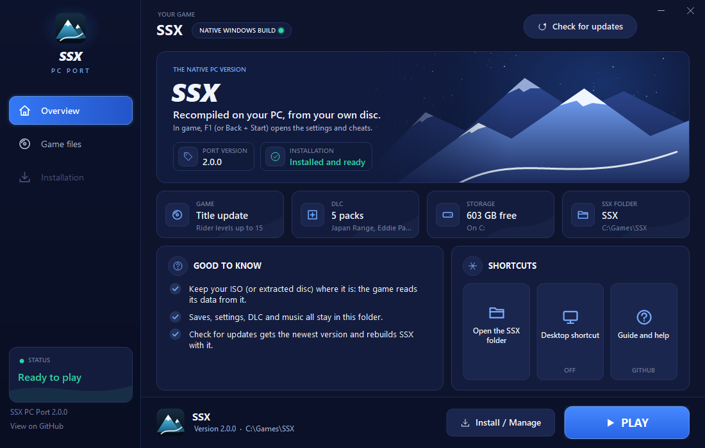
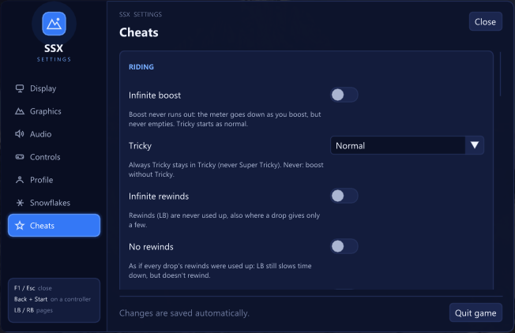

<div align="center">

# 🏂 SSX (2012) — Native PC Port

**EA's SSX, running natively on Windows and Linux — up to 300 fps, up to 4K, no emulator.**

[](../../releases/latest)
[](#installing)
[](#linux)
[](LICENSE)
<a href="https://playported.com/ports/1191-ssx/"></a>

<a href="https://recomplauncher.com/game/ssx-recomp"><picture><source media="(prefers-color-scheme: dark)" srcset="https://recomplauncher.com/assets/press/launcher/badge-light.svg"></picture></a>

[**⬇️ Download**](../../releases/latest) · [✨ Features](#features) · [🛠️ Install](#installing) · [🎮 Controls](#playing) · [🖥️ Graphics](#graphics) · [📦 DLC](#adding-dlc) · [🎵 Music](#your-music) · [📝 Changelog](../../releases)

</div>

> [!CAUTION]
> **You need your own copy of SSX (USA) for Xbox 360**, dumped from your own disc to an ISO. This
> repository contains no EA code or content, and none is downloaded. ISOs and pre-built games will
> not be provided.

SSX's Xbox 360 code, statically recompiled to x86-64 with the
[ReXGlue SDK](https://github.com/rexglue/rexglue-sdk) and built on your own PC from your ISO.
Graphics run on Direct3D 12 (Vulkan on Linux).

<div align="center">

[](https://www.youtube.com/watch?v=ibGjbR-AqRo)

<a id="screenshots"></a>



 

</div>

<a id="features"></a>

## ✨ Features

- ⚡ **Up to 300 fps** and **up to 4K**, at real-time game speed (the original runs at 30)
- 🧊 **Barely any first-ride stutter**: shaders are prepared on the first start
- ⚙️ **Settings menu** in game: **F1**, or **Back + Start** on a controller
- ⌨️ **Keyboard & controller**, with key rebinding, vibration and deadzone
- 📦 **DLC and the title update** from your own console, with riders up to **level 15**
- 🎵 **Your own music** as playlists, remixed live as you ride
- 🪪 **Your name and picture**, a **snowflake tracker**, the **boost meter in freeride**, **gear by type** and the **online-only badges**
- 🎮 **Cheats**: infinite boost, always Tricky, slow motion, infinite wingsuit lift, gear that never wears out, ride uphill and more

<a id="installing"></a>

## 🛠️ Installing

### 🪟 Windows

1. Download **`ssx-recomp.exe`** from the [latest release](../../releases/latest) and put it in an
   empty folder, like `C:\Games\SSX`. That folder is your SSX folder.
2. Run it (SmartScreen: **More info → Run anyway**).
3. Click **Get started**, pick your ISO (or an extracted disc's `default.xex`), optionally
   **Add files...** for [DLC and the title update](#adding-dlc), and click **Install**.
4. After 10–30 minutes, click **Play**. From then on, `ssx-recomp.exe` is the game's launcher.

Needs Windows 10/11 x64, about 10 GB free and an internet connection for the first build.

**Or use [RecompLauncher](https://recomplauncher.com/game/ssx-recomp):** drop in your ISO and it
builds the game for you.

> [!TIP]
> - 🔄 **Updating:** click **Check for updates**. Your saves and settings stay.
> - 💿 **Keep your ISO** where it is: the game reads its data from it every start.
> - 📁 **Everything stays in your SSX folder** (saves, settings, DLC, music, caches). Back it up or
>   move it as a whole.

<details>
<summary><b>More about the install</b></summary>
<br>

- **What it does:** unpacks the port's source (carried inside `ssx-recomp.exe`), checks your ISO,
  installs missing build tools (CMake, Ninja, LLVM, Visual Studio 2022 Build Tools; Windows asks
  for permission), downloads the prebuilt ReXGlue SDK and ReGPU renderer (no game code), and
  builds the game into `source\dist\SSX`. Its source is
  [`installer/SSXInstaller.cs`](installer/SSXInstaller.cs).
- **Offline:** only build tools are downloaded, so a later rebuild (for example to add the title
  update) works offline. Playing never goes online.
- **Coming from `SSX-Installer.exe` or `Documents\ssx`?** Put `ssx-recomp.exe` in the old install
  folder (`SSX-PC` in your user folder), run it, then **Install / Manage → Rebuild**. Saves from
  `Documents\ssx` are copied over on the first start.
- **Something went wrong?** Attach `source\build-ssx.log` to an issue.
- **Supported disc:** SSX (USA), title ID `4541096D`, `default.xex` SHA-256
  `F509845401D65A6791C5D28A3E9636A6558DA204F3851028B0B369A44A4B68EA`. Some "World" ISOs are this
  same release; the installer checks it for you.

</details>

<a id="linux"></a>

### 🐧 Linux (beta)

1. Download **`ssx-linux-installer.sh`** from the [latest release](../../releases/latest).
2. Run `bash ssx-linux-installer.sh --iso ~/Games/SSX.iso` (add `--title-update <file>` for the
   title update).
3. When it says **DONE**, start **SSX** from your app menu.

Needs about 15 GB free and 20–60 minutes the first time; it asks for `sudo` to install build tools.
Run it again to update. Tested on CachyOS with an NVIDIA GTX 1080; Debian/Ubuntu and Fedora reports
are welcome.

<details>
<summary><b>Linux notes</b></summary>
<br>

- Saves, `dlc` and `music` live in `~/.local/share/ssx` (where this README says `userdata`). Your
  own music needs `ffmpeg`.
- The port goes to `~/SSX-PC` (`--folder` picks another place). RecompLauncher can't build SSX on
  Linux yet.
- Not on Linux yet: the gamer picture. The standard renderer runs at 1× only.
- If something goes wrong, attach `~/SSX-PC/source/build-ssx-linux.log` to an issue.

</details>

<a id="playing"></a>

## 🎮 Playing

| | |
|---|---|
| ⚙️ **Settings** | **F1** / **Esc**, or **Back + Start** (D-pad moves, **A** changes, **LB/RB** switch pages, **B** closes) |
| ⌨️ **Keyboard** | WASD steer · Space jump · arrow keys trick stick · Q/E triggers · 1/3 bumpers · Enter start · Tab back |

> [!TIP]
> - **Tearing?** Turn on **VSync** in **F1 → Display**.
> - **More frames?** Lower **F1 → Graphics → Resolution**.
> - **Won't start after changing a setting?** Delete `ssx.toml` next to `ssx.exe`.

<a id="graphics"></a>
<a id="regpu"></a>

## 🖥️ Graphics

**[ReGPU](https://github.com/zer0ducksgiven/ReGPU)** is the default renderer: it draws at your
screen's resolution (720p to 4K) and runs about 200 fps at 1440p on an RTX 4080 SUPER. The
**Standard** renderer (1200×640 at 1×, 2× or 3×, with FSR/CAS/FXAA) is the fallback in
**F1 → Graphics → Renderer**, and the game switches to it by itself if ReGPU can't start.

- **Frame rate:** **F1 → Display**: 30 up to 300, or match your monitor.
- **Ultrawide** screens get a 16:9 picture for now.
- Something looks wrong? A screenshot helps a lot (**F12** saves one with debug data).

<a id="frame-rate-lock"></a>

<details>
<summary><b>Why the standard renderer's 3× is locked to 60 fps</b></summary>
<br>

3× draws about 4K through an emulation of the Xbox 360's video memory. Even an RTX 4080 SUPER sits
at 99% there: above 60 fps the frame rate jumps around and some drivers hang. 2× (or ReGPU) is
recommended; 4× was removed for the same reason.

</details>

<a id="adding-dlc"></a>

## 📦 DLC and the title update

Neither is included: they come from **your own Xbox 360**. All five DLC packs work (Mount Eddie,
the Presell Pack, Japan Range, Eddie Pack and Mac Board Pack), and so does title update **0.0.3.2**,
which adds the gear for levels 11 to 15.

**To add them:** in `ssx-recomp.exe`, click **Install / Manage → Add files...**, pick the files, then
**Add DLC** (or **Rebuild** for the title update).

<details>
<summary><b>Getting the files off your console</b></summary>
<br>

Copy them from your console's drive with an Xbox 360 file tool (like *FATXplorer*, *Velocity* or
*Horizon*). Copy the long-named package files themselves, not their folders:

| | Folder on the console |
|---|---|
| DLC | `Content\0000000000000000\4541096D\00000002\` |
| Title update | `Content\0000000000000000\4541096D\000B0000\` (if there are two, use the larger, ~9 MB) |

DLC can also be copied by hand into `userdata\dlc`; the game installs it at the next start (the log
in `logs` says `DLC: installed`). Mt. Eddie and Japan then show on the world map.

</details>

<a id="title-update"></a>
<a id="level-15"></a>

<details>
<summary><b>The title update and levels 11 to 15</b></summary>
<br>

- **Level cap:** EA raised it from 10 to 15 through online tuning updates the port can't download.
  With the title update installed, the port applies the same level tables itself: a level 10 rider
  can buy access to level 11 for 1,000,000 credits, and so on up to 15. A save that already has
  EA's tuning update keeps using it.
- **Saves** work with and without the title update.
- **Back to the disc version:** run `source\scripts\build-ssx.ps1 -NoTitleUpdate` from your SSX
  folder (it asks for your ISO again).

</details>

<a id="your-music"></a>

## 🎵 Your own music

1. Put your music in `userdata\music`, one folder per playlist (like `music\Chill\`). MP3, M4A/AAC,
   WMA, FLAC and WAV work.
2. In the game, press **Back** on the main screen, then **Music → Personalize Your Music**.
3. Pick **Playlist** and one of your folders for race, trick, survive or menu music.

## 🗺️ Roadmap

**Being worked on:** playing through every region to find bugs, Linux testing on more PCs, and
installer reliability.

**Known issues:**
- Only SSX (USA) is supported, with or without title update 0.0.3.2.
- Online features (RiderNet, global events, online races) need Xbox Live and don't work. The
  online-only badges can be shown as earned (**F1 → Profile**).
- Ultrawide screens get a 16:9 picture.

What changed in each version is on the [releases page](../../releases).

> [!TIP]
> **Found a bug?** [Open an issue](../../issues/new) with a screenshot, where it happened, and, if
> the game crashed, the newest file from the `logs` folder next to `ssx.exe`.

<details>
<summary><b>🧑‍💻 Building manually / development</b></summary>
<br>

```powershell
powershell -ExecutionPolicy Bypass -File scripts\build-ssx.ps1 -Iso "D:\path\to\your\SSX.iso"
```

`patches/` holds the fixes applied to the ReXGlue SDK (`rexglue-*`) and to ReGPU (`regpu-*`),
`ssx_config.toml` holds the recompilation overrides, and `src/` holds the PC-side code (settings,
launcher, hooks). [`PROGRESS.md`](PROGRESS.md) is the development log.

The builder uses the CMake preset `ssx-player`, which builds against the prebuilt SDK package made
by [`scripts/build-sdk-package.ps1`](scripts/build-sdk-package.ps1) (the SDK source at a fixed
commit plus `patches/`). For SDK development, the `ssx-release` preset builds the SDK from source
in `tools/rexglue-src`. ReGPU is loaded as a ReXGlue GPU plugin (`regpu-plugin/`, adapted from
[Glue2GPU](https://github.com/zer0ducksgiven/Glue2GPU)); the installer downloads it prebuilt from
the `regpu-*` releases ([`scripts/build-regpu-package.ps1`](scripts/build-regpu-package.ps1)), and
`scripts\build-regpu.ps1` builds it from source.

</details>

<details>
<summary><b>🚀 For launchers: installing without a window</b></summary>
<br>

Both installers also run without a window, for a launcher that installs the game for the player:

```
ssx-recomp.exe          --game <ISO or extracted folder> [--folder <folder>] [--title-update <file>] [--dlc <file>]...
ssx-linux-installer.sh  --iso <ISO> --folder <folder> [--title-update <file>] [--no-menu]
```

On Windows `--game` (or `--iso`) takes the disc image or the extracted disc's folder, every option
also takes its value after `=` (`--dlc=<file>`), and `--folder` defaults to the folder
`ssx-recomp.exe` is in. `--prepare` prints only `progress <0-1> <step>` lines and, when it fails,
the reason as its last line (it's [RecompLauncher's](recomplauncher.json) setup step). The exit code
says what happened:

| Code | |
|---|---|
| 0 | the game is built |
| 2 | wrong options |
| 10 to 13 | your copy of the game: not found or not readable (10), not an Xbox 360 game (11), not the supported release (12), removed by an antivirus program (13) |
| 20 to 22 | the title update: not found or not readable (20), not the supported one (21), incomplete (22) |
| 30, 31 | the build tools couldn't be installed (30), or Visual Studio's are incomplete and couldn't be repaired (31) |
| 40 | a download failed |
| 50 | the build failed (the details are in `source\build-ssx.log`) |
| 1 | something unexpected |

The game itself (`ssx.exe`) takes `--game <ISO or folder>` too, for that start only. It exits with
10 when it has no copy of the game to start, 11 when it's built for the title update but the
update's files are missing, and ReXGlue's 1 when it couldn't start or read the disc.

The game ends up in `<folder>/source/dist/SSX/ssx.exe` (Windows) or
`<folder>/source/dist/SSX/ssx` (Linux), set up to read the ISO it was built from; a first build takes
10–30 minutes, longer when build tools have to be installed. `--no-menu` leaves the player's own SSX
app-menu entry alone (Linux; accepted and ignored on Windows, which makes no shortcut here). Without
a terminal, the Linux installer installs missing build tools through the desktop's password prompt
(pkexec) instead of sudo.

</details>

## 🙏 Credits

- [ReXGlue SDK](https://github.com/rexglue/rexglue-sdk) by Tom Clay: the static recompilation toolkit and runtime
- [Xenia](https://xenia.jp): the Xbox 360 research the ReXGlue runtime is derived from
- [XenonRecomp](https://github.com/hedge-dev/XenonRecomp) (hedge-dev): the codegen approach ReXGlue builds on
- [xenia-canary game patches](https://github.com/xenia-canary/game-patches) (Margen67): the SSX 60 fps and render size findings
- [ReGPU](https://github.com/zer0ducksgiven/ReGPU) and [Glue2GPU](https://github.com/zer0ducksgiven/Glue2GPU)
  (MIT): the ReGPU renderer and its ReXGlue plugin
- [vkd3d-proton](https://github.com/HansKristian-Work/vkd3d-proton): Direct3D 12 on Vulkan for the Linux version
- AMD FidelityFX (FSR / CAS)

---

<div align="center">

<sub>⚖️ Unofficial fan project, not affiliated with or endorsed by Electronic Arts.</sub><br>
<sub><i>SSX</i> is a trademark of Electronic Arts Inc.</sub><br>
<sub>The code in this repository is released under the <a href="LICENSE">MIT license</a></sub><br>
<sub>and contains no Electronic Arts code or assets.</sub>

</div>
